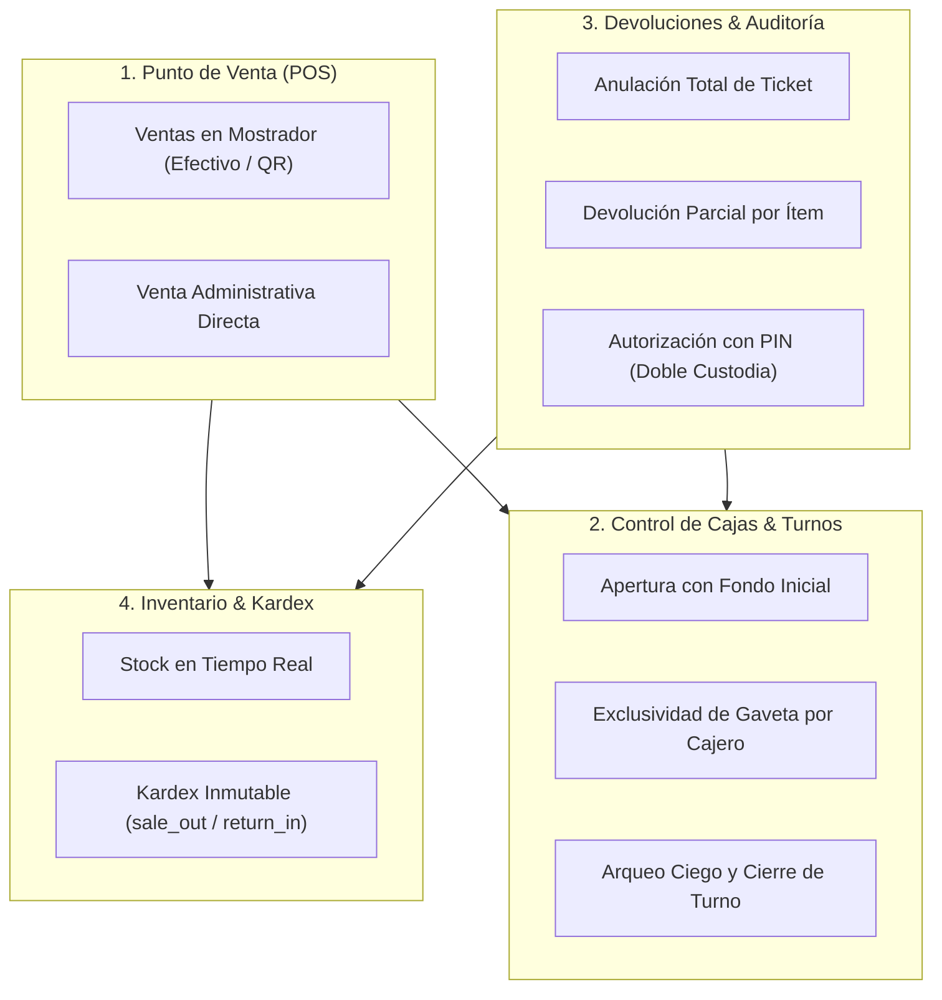

# 📘 Resumen Ejecutivo del Sistema ERP y Validaciones Implementadas

> **Documento Oficial de Arquitectura, Reglas de Negocio y Trazabilidad Operativa**  
> *Aura Commerce - Sistema POS, Inventario, Cajas y Ventas*  
> *Fecha de compilación:* Noviembre 2026

---

## 🚀 1. Resumen de Módulos Activos en el ERP

El sistema está diseñado bajo el enfoque de **ERP ágil, seguro y de alto rendimiento**, priorizando la integridad de inventario, auditoría de dinero en efectivo y prevención de fraudes:

---

## 👥 2. Gestión de Usuarios, Roles y PIN de Seguridad

* **Ruta en el sistema:** `/admin/usuarios`
* **Roles del sistema:**
  1. **👑 Administrador (`admin`):** Control total del ERP, reportes, inventario, compras, configuración de cajas y autorización de devoluciones mediante **PIN**.
  2. **👔 Supervisor (`manager`):** Supervisión de piso de venta, validación de arqueos, auditorías y autorización de devoluciones en mostrador mediante **PIN**.
  3. **🏷️ Cajero (`cashier`):** Operador exclusivo de su gaveta física asignada. **No puede autorizar devoluciones por sí mismo ni cobrar en cajas ajenas.**
  4. **📦 Almacenero (`warehouse`):** Recepción de mercancía de compras y ajustes de existencias por conteo físico o mermas.
* **Seguridad por PIN Numérico:**
  - Los usuarios con rol `admin` y `manager` tienen un campo `pin` (4 a 6 dígitos).
  - Permite autorizar transacciones críticas en el mostrador rápidamente sin necesidad de cerrar e iniciar sesión en el navegador.

---

## 💵 3. Reglas de Control de Cajas y Turnos

1. **Apertura Obligatoria:**  
   Ningún cajero puede procesar ventas sin haber registrado formalmente su **Fondo Inicial de Gaveta**. Si no tiene turno abierto, la terminal de cobro se bloquea automáticamente.
2. **Exclusividad Absoluta de Gaveta:**  
   Un turno (`cash_shifts`) pertenece exclusivamente al usuario que lo abrió. El Administrador **no puede** registrar cobros en la caja de un cajero para no distorsionar el arqueo físico de ese empleado.
3. **Régimen de Venta del Administrador:**  
   - Si cobra en mostrador físico, abre su propia caja registrante.
   - Si cobra ventas mayoristas o fuera de mostrador, emite **Venta Administrativa Directa** (`cash_shift_id = NULL`), la cual descuenta inventario en Kardex pero no altera gavetas de cajeros.
4. **Aislamiento de Operaciones entre Cajas (Protección Cruzada de Arqueo):**  
   - Si una venta fue realizada en la **Caja 1** (Cajero 1), el **Cajero 2** únicamente tiene permiso de **ver e imprimir el ticket** (modo solo lectura).
   - Los botones de **Anular** y **Devolver** quedan **bloqueados u ocultos** para el Cajero 2.
   - **Razón contable:** Si el Cajero 2 devolviera dinero en efectivo de su propia gaveta por una venta que cobró la Caja 1, la Caja 2 terminaría con un faltante injustificado y la Caja 1 con un sobrante.
   - Solo la **misma caja emisora** (o un **Administrador / Supervisor con PIN**) puede procesar devoluciones o anulaciones.

---

## 🔄 4. Flujo de Devoluciones y Anulaciones (Doble Custodia)

El sistema soporta **ambos estándares de la industria**, diferenciados según la causa:

| Tipo de Operación | Cuándo se usa | Acción en Inventario (Kardex) | Acción en Caja / Dinero | Estado en BD |
| :--- | :--- | :--- | :--- | :--- |
| **Anulación Total** | Error inmediato de cobro o cliente cancela el 100% de la compra al instante. | Repone el 100% de los productos con movimiento `return_in`. | Descuenta el total de la venta del turno de caja (`cashSales` y `expectedCash`). | `cancelled` |
| **Devolución Parcial por Ítem** | Cliente devuelve 1 o más productos específicos de una compra múltiple. | Repone **únicamente las unidades seleccionadas** con movimiento `return_in`. | Descuenta el monto exacto devuelto en efectivo de `expectedCash`. Si es QR, no afecta saldo físico. | `refunded` (Devolución Parcial o Total) |

### 🛡️ Protocolo Antifraude de Devolución Parcial:
1. El cajero localiza la venta en el historial y presiona **Devolver**.
2. Selecciona con los selectores `[ - ] [ + ]` cuántas unidades de cada producto regresan (con validación estricta para no exceder las unidades compradas).
3. Selecciona método de reintegro: **Efectivo** o **QR / Transferencia**.
4. **Validación de Seguridad:** Se exige el PIN de 4 dígitos de un Administrador o Supervisor activo.
5. El sistema emite un **Vale de Devolución Térmico (80mm)** con número de comprobante propio, detalle de productos devueltos y firma/auditoría del supervisor.

---

## 🗄️ 5. Estructura de Base de Datos y Fórmulas Contables

Para que cualquier auditoría, reporte o arqueo ciego sea infalible, la tabla `sales` almacena:

$$\mathbf{total\_amount} - \mathbf{refunded\_amount} = \mathbf{net\_amount}$$

* **`total_amount` (Monto Original):** Valor bruto original con el que se emitió el ticket (ej: **450.00 Bs**).
* **`refunded_amount` (Monto Devuelto):** Importe acumulado que se reintegró al cliente (ej: **50.00 Bs**).
* **`net_amount` (Monto Neto Real):** Saldo final real cobrado (ej: **400.00 Bs**).

### Impacto en Arqueos Ciegos (`cash_shifts`):
* Al momento del cierre de caja, el saldo esperado de la gaveta (`expectedCash`) se calcula sobre el dinero físico real que debe haber:
  $$\text{expectedCash} = \text{Fondo Inicial} + \text{Ventas en Efectivo} - \text{Devoluciones en Efectivo}$$
* Si una venta fue de 450 Bs y se devolvieron 50 Bs en efectivo, la gaveta exige físicamente **400 Bs**. Si el cajero cuenta 400 Bs, el cuadre es exacto (`difference = 0.00`).

---

## 🇧🇴 6. Adaptación al Mercado Boliviano
* **Moneda Oficial:** Bolivianos (`Bs` / `BOB`).
* **Formatos de Cobro en POS:** Exclusivamente **Efectivo** (con atajos de billetes bolivianos de 10, 20, 50, 100 y 200 Bs) y **QR Simple / Bancario**.
* Se eliminó el uso de tarjeta tanto en la botonera de cobro como en los métodos de reintegro de devoluciones.

---

## 📊 7. Módulos de Reportes: Cierre Diario (Z) vs Periodos e Histórico

Para dar cobertura total a la gestión del negocio, se separaron dos herramientas complementarias:

### A. Reporte Z & Cierre Fiscal Diario (`/admin/reportes`)
* **Propósito:** Automatizar el corte oficial diario para auditoría fiscal, arqueo de dinero en caja y comprobante físico.
* **Componentes del Reporte Z:**
  1. **Estado de Resultados del Día:** Ventas brutas, devoluciones, ventas netas, costo de mercancía (COGS) y ganancia bruta en Bs y %.
  2. **Auditoría de Gavetas & Cajas:** Fondos iniciales, recaudación en efectivo, QR simple y arqueos ciegos (diferencia física entre esperado y contado).
  3. **Tira Térmica 80mm Oficial de Cierre:** Comprobante para ticketera con líneas de firma del cajero y supervisor.
  4. **Exportación a Excel / CSV:** Descarga del reporte diario en formato compatible con hojas de cálculo.

### B. Reportes por Periodo & Analítica (`/admin/analitica`)
* **Propósito:** Análisis financiero multidía, consolidación semanal, mensual, anual o rangos de fechas personalizados.
* **Selectores de Rango:**
  - **Filtros Rápidos:** *Esta Semana (últimos 7 días)*, *Este Mes*, *Últimos 30 días*, *Año Actual*.
  - **Rango Libre:** Selectores de **Fecha Inicio** y **Fecha Fin** sin restricciones de tiempo.
* **Métricas y Vistas:**
  1. **Gráfico de Evolución Diaria:** Tendencia día por día de ventas netas, costos y ganancias.
  2. **Ranking de Top Productos:** Artículos más vendidos, unidades devueltas, volumen facturado y margen comercial.
  3. **Desempeño de Cajeros:** Rendimiento individual de cada cajero (tickets emitidos, recaudación en efectivo vs QR y total neto).
  4. **Listado Detallado de Ventas:** Buscador en vivo por ticket, cliente o cajero con selector de método de pago.
  5. **Exportación Consolidada a Excel:** Descarga de todo el periodo en formato CSV estructurado.

---

## 📌 8. Estado de Verificación Técnica
- **Compilador TypeScript (`tsc`):** 0 errores.
- **Neon PostgreSQL:** Columnas `users.pin`, `sale_items.returned_quantity`, `sales.refunded_amount` y `sales.net_amount` migradas y operativas.
- **Rutas verificadas:**
  - `http://localhost:3000/admin/reportes` (HTTP 200 OK - Reporte Z Diario)
  - `http://localhost:3000/admin/analitica` (HTTP 200 OK - Reportes por Periodo)
  - `http://localhost:3000/admin/ventas` (HTTP 200 OK)
  - `http://localhost:3000/admin/usuarios` (HTTP 200 OK)
  - `http://localhost:3000/admin/cajas` (HTTP 200 OK)
  - `http://localhost:3000/admin/inventario` (HTTP 200 OK)

---

## ⚡ 9. Estándar de Paginación y Optimización de Rendimiento
Para evitar sobrecarga en el navegador con grandes volúmenes de datos, el sistema implementa el componente compartido [`PaginationBar`](file:///c:/Users/neida.DESKTOP-801C70S/Desktop/sistemas%20next/sistema%20pos%20inventario%20ecommerce/src/components/ui/pagination-bar.tsx) (15 registros por página, indicador de rango "Mostrando X a Y de Z", números de página inteligentes con elipsis y botones anterior/siguiente):

1. **Tablas con Paginación Activa (15 por página):**
   - **Historial de Ventas POS (`/admin/ventas`):** Evita renderizar cientos de ventas pasadas en una sola carga.
   - **Detalle de Ventas del Día (`/admin/reportes`):** Paginado a 15 tickets con buscador en vivo.
   - **Top Productos del Día (`/admin/reportes`):** Paginado a 15 artículos por página.
   - **Todas las Ventas del Periodo (`/admin/analitica`):** Paginación obligatoria para consultas semanales, mensuales o anuales.
   - **Top Productos del Periodo (`/admin/analitica`):** Paginado a 15 productos con ranking acumulativo `(página - 1) * 15 + posición`.
   - **Inventario & Kardex (`/admin/inventario`):** Paginado a 10 productos/movimientos por página.

2. **Tablas sin Paginación (Criterio de Volumen Reducido):**
   - **Arqueo de Turnos:** 1 a 4 turnos diarios (el supervisor requiere ver el cuadre completo en una sola vista).
   - **Rendimiento de Operadores:** 2 a 5 cajeros/empleados del negocio (tabla ejecutiva compacta).
   - **Evolución Diaria (Semana/Mes):** 7 a 30 días con scroll natural optimizado.

---

## 🔒 10. Seguridad de Sesión, Autenticación Real y Control de Acceso (RBAC)

Para operar en un entorno de producción real sin simulaciones ni datos falsos:

1. **Autenticación con Cookies HTTP-Only y Firma Criptográfica:**
   - La sesión del usuario se almacena en la cookie `aura_session` con flags `httpOnly`, `sameSite: "lax"` y `secure` en producción.
   - La firma del token de sesión utiliza **HMAC-SHA256 con Web Crypto (`crypto.subtle`)**, lo que garantiza compatibilidad tanto en el Edge Runtime de Next.js (`middleware.ts`) como en Server Components y Server Actions de Node.js.
   - Los tokens son inmutables: cualquier intento de alteración en el cliente invalida automáticamente la firma criptográfica y destruye la sesión.

2. **Criptografía de Contraseñas:**
   - Implementado mediante **PBKDF2 nativo de Node.js** (`crypto.pbkdf2Sync`) con sal única aleatoria de 16 bytes y 100,000 iteraciones con digest SHA-512 (`src/lib/auth/password.ts`).
   - Se incluye soporte transparente para actualización de contraseñas heredadas de desarrollo.

3. **Eliminación Total de Selectores Falsos en el POS:**
   - Se removió por completo el `<select>` desplegable que permitía cambiar de operador arbitrariamente en el punto de venta (`/admin/ventas`).
   - El POS ahora enlaza de forma fija, transparente e inalterable la identidad del cajero o administrador autenticado (`useAuth()`), impidiendo suplantaciones de identidad en las ventas o arqueos.

4. **Guards de Ruta en Middleware (`middleware.ts`):**
   - Redirección automática de usuarios no autenticados a `/portal` con parámetro de retorno.
   - Enrutamiento inteligente post-login según el rol del usuario:
     - `cashier` -> `/admin/ventas` (Terminal POS).
     - `warehouse` -> `/admin/inventario` (Inventario & Almacén).
     - `admin` y `manager` -> `/admin` (Panel General).
   - Bloqueo y redirección de rutas no autorizadas (ej. si un cajero o supervisor intenta acceder a `/admin/usuarios`, es bloqueado y redirigido a su área de trabajo con alerta de acceso denegado).

5. **Guards en Server Actions:**
   - Todas las Server Actions críticas (`users.ts`, `reports.ts`, `analytics.ts`, `purchases.ts`, `suppliers.ts`, `products.ts`, `cash-shifts.ts`, `sales.ts`) validan la identidad con `requireAuth()` o `requireRole([...])`.
   - Los asientos de Kárdex y actas de baja registran el `userId` real del usuario autenticado en la sesión en lugar de identificadores fijos.

6. **Panel General (`/admin`) Conectado a Neon PostgreSQL:**
   - Se sustituyeron todos los arrays de datos de ejemplo por la Server Action `getDashboardSummaryAction()`.
   - Métricas en vivo en moneda boliviana (`Bs`): facturación mensual real, utilidad bruta auditada, ticket promedio, saldo en gavetas físicas, lista de tickets del día con desglose de ganancia, alertas de stock crítico y auditoría de bajas.

