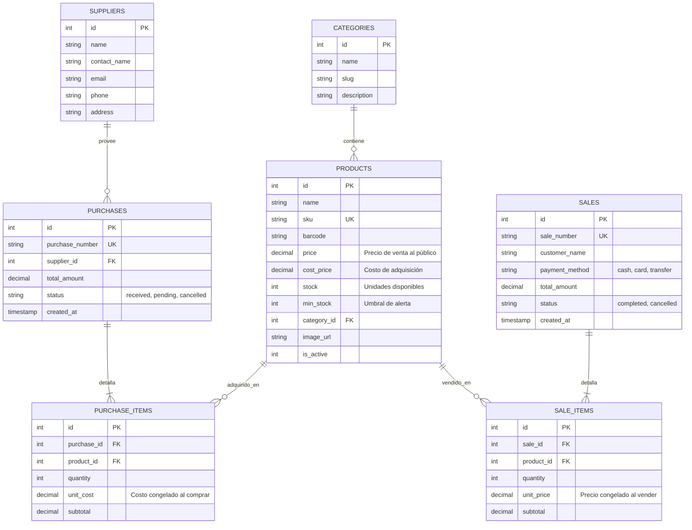

# 🏗️ Stack Tecnológico y Arquitectura del Sistema

## 1. Stack Tecnológico

| Capa | Tecnología | Versión | Justificación |
| :--- | :--- | :--- | :--- |
| **Gestor de Paquetes** | **pnpm** | `v10.33+` | Máxima velocidad de instalación, eficiente uso de disco con store global. |
| **Framework** | **Next.js (App Router)** | `v16.4+` | React Server Components (RSC), Turbopack, optimización automática de imágenes y despliegue nativo en Vercel. |
| **Librería Core** | **React** | `v19+` | Hooks modernos, soporte de acciones del servidor y transiciones fluidas. |
| **Lenguaje** | **TypeScript** | `v5+` | Tipado estricto en toda la aplicación (desde la base de datos hasta los componentes visuales). |
| **Estilos** | **Tailwind CSS** | `v4` | Rendimiento de compilación ultrarrápido, utilidades modernas y variables CSS nativas. |
| **Componentes UI** | **shadcn/ui** | `v4.23+` | Componentes accesibles y modulares (Radix/Base UI). **Cero cajas negras**: el código fuente vive dentro de tu propio proyecto. |
| **Iconografía** | **Lucide Icons** | `v1.64+` | Iconos vectoriales limpios, ligeros y consistentes. |
| **Base de Datos** | **Neon PostgreSQL** | Serverless | Base de datos PostgreSQL serverless alojada en la nube, con escalado automático a cero y latencia mínima para Vercel. |
| **ORM** | **Drizzle ORM** | `v0.45+` | ORM TypeScript de alto rendimiento, nativo para entornos serverless (HTTP driver) sin saturar conexiones. |
| **Tablas de Datos** | **@tanstack/react-table** | `v9+` | Paginación, ordenamiento, filtrado en vivo y columnas personalizadas. |
| **Formularios & Validación** | **React Hook Form + Zod** | `v7` / `v4` | Rendimiento óptimo sin re-renderizados innecesarios y validación estricta compartida entre cliente y servidor. |
| **Notificaciones** | **Sonner** | `v2+` | Toasts elegantes, no intrusivos y totalmente personalizables. |

---

## 2. Filosofía de Diseño: "Anti-Caja Negra" (Por qué NO Filament)

En sistemas como Laravel Filament o similares, los componentes están encapsulados en paquetes de terceros (`vendor/`), lo que hace que cambiar un estilo, alterar un layout o adaptar una vista para móvil requiera overrides complejos o hacks frágiles.

En este sistema:
* **Propiedad total del código:** Cada componente vive en `src/components/ui/` (`button.tsx`, `table.tsx`, `card.tsx`, etc.).
* **Personalización total:** Si deseas cambiar un borde, una sombra o el espaciado para móviles, simplemente modificas las clases de Tailwind en ese archivo.
* **Componentes desacoplados:** La interfaz visual no depende de la lógica de la base de datos.

---

## 3. Arquitectura del Código (Modular Layered Architecture)

La estructura del proyecto organiza responsabilidades de forma clara:

```
src/
├── app/                          # Rutas y páginas de Next.js (App Router)
│   ├── (admin)/                  # Panel de gestión interna
│   │   ├── layout.tsx            # Shell responsivo (Sidebar + Mobile Drawer)
│   │   ├── page.tsx              # Dashboard con métricas visuales
│   │   ├── inventario/           # Gestión de productos y stock
│   │   ├── ventas/               # Registro de ventas y POS
│   │   ├── compras/              # Registro de compras a proveedores
│   │   └── proveedores/          # Directorio de proveedores
│   ├── catalogo/                 # Catálogo público tipo e-commerce para clientes
│   ├── layout.tsx                # Layout raíz (fuentes, metadatos, toast container)
│   └── globals.css               # Tokens de diseño y variables de tema
│
├── components/                   # Componentes de interfaz de usuario
│   ├── ui/                       # Primitivas de shadcn (button, card, dialog, table...)
│   ├── layout/                   # Componentes estructurales (Sidebar, MobileNav, Header)
│   └── modules/                  # Componentes específicos de cada dominio:
│       ├── inventario/           # ProductCardMobile, ProductTableDesktop, StockBadge
│       ├── ventas/               # PosProductGrid, CartDrawer, ReceiptModal
│       ├── compras/              # PurchaseItemRow, SupplierForm
│       └── catalogo/             # PublicProductCard, CategoryFilter
│
├── db/                           # Capa de datos
│   ├── index.ts                  # Cliente Neon PostgreSQL con Drizzle
│   ├── schema.ts                 # Definición de tablas y relaciones
│   └── queries/                  # Consultas SQL optimizadas
│
├── actions/                      # Server Actions (Lógica de negocio y transacciones)
│   ├── products.actions.ts
│   ├── sales.actions.ts
│   └── purchases.actions.ts
│
└── lib/                          # Utilidades generales
    ├── validations/              # Esquemas Zod (validación de formularios)
    └── utils.ts                  # Funciones de formateo (moneda $, fechas, cn)
```

---

## 4. Estructura de la Base de Datos (Modelo Relacional Estándar)

El modelo implementa el estándar relacional **Cabecera - Detalle**:



---

## 5. Estrategia de Diseño Mobile & Desktop

1. **Mobile-First Real:**
   * No se fuerza una tabla de 10 columnas en una pantalla de teléfono de 380px. En mobile, las vistas cambian a tarjetas sintetizadas con información clave (`Nombre`, `Precio`, `Stock Badge`).
   * Los botones primarios de acción (ej. *"Cobrar"*, *"Nuevo Producto"*) se ubican en zonas de fácil alcance para el pulgar.
2. **Desktop Productivo:**
   * Uso eficiente de pantallas grandes con vistas de dos paneles (ej. POS: catálogo a la izquierda, ticket/carrito a la derecha).
   * Tablas densas con filtros rápidos y atajos de teclado.
