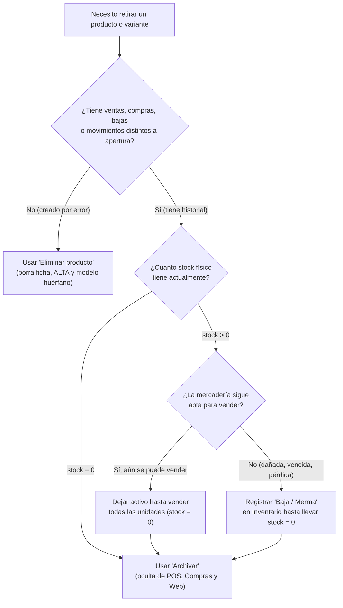

# Ciclo de Vida de Productos: Stock Inicial, Eliminar vs. Archivar y Reportes

Este documento explica qué ocurre exactamente en la base de datos y en la contabilidad del sistema cuando creas, editas, eliminas o archivas un producto o variante.

---

## 1. Alta de Productos: Stock Inicial vs. Compras y Costo Promedio (CPP)

### ¿Qué hace el Stock Inicial al crear un producto?
Cuando creas un producto (simple o con variantes) desde `/admin/inventario/nuevo` e ingresas un **Stock Inicial** y un **Costo Inicial**:

1. La consulta SQL transaccional [`createCatalogProductsQuery`](../src/db/operations/catalog.ts) crea el modelo (si aplica) y el registro en la tabla `products`.
2. Inmediatamente inserta un asiento automático en el Kárdex (`inventory_movements`) con:
   - `movement_type = 'adjustment_in'`
   - `reference_type = 'product_creation'`
   - Referencia visual: `ALTA-#<id>`
   - Motivo: `"Apertura inicial del producto"`
   - `previous_stock = 0`, `new_stock = stock`, `unit_cost = cost_price`
3. **No** crea una orden de compra, **no** asocia deuda/pago con proveedor y **no** toca el efectivo ni los turnos de caja.

### ¿Cuándo usar Stock Inicial y cuándo usar Compras?

| Situación real | Qué hacer en el sistema | Por qué |
| :--- | :--- | :--- |
| **Inventario que ya tenías en tienda/almacén** antes de arrancar con el sistema | Cargar cantidad y costo en **Stock Inicial** al crear el producto | Registra tu capital inicial en almacén (`ALTA-#ID`) sin simular una compra de hoy ni alterar la caja. |
| **Mercadería recién comprada a un proveedor** (hoy o en el día a día) | 1. Crear el producto con **Stock = `0`** (y costo referencial o `0`) 2. Ir a `/admin/compras/nueva` y registrar la compra con su factura y proveedor | Deja trazabilidad de proveedor, método de pago, documento, entrada `purchase_in` en Kárdex y recalcula el **Costo Promedio Ponderado (CPP)**. |

### ¿Por qué el Stock y el Costo están bloqueados al editar?
En `/admin/inventario/[id]/editar`, tanto las existencias (`stock`) como el costo (`costPrice`) son de solo lectura. Esto garantiza que ninguna modificación manual silenciosa rompa el Kárdex ni la valorización del inventario. Todo cambio posterior de stock o costo ocurre mediante operaciones auditables: **Compras**, **Ventas**, **Devoluciones** o **Actas de Baja/Merma**.

---

## 2. Eliminar Definitivamente vs. Pausar (Inactivo) vs. Archivar

El sistema distingue tres acciones claras según el ciclo de vida del artículo:

| Criterio | Eliminar definitivamente | Inactivo (Pausar) | Archivar (Largo plazo) |
| :--- | :--- | :--- | :--- |
| **Uso habitual** | Corregir un producto cargado por error (`canHardDelete = true`). | Pausar temporalmente (reposición pendiente, revisión de precio, falta momentánea). | Retiro de catálogo por tiempo indefinido o fin de temporada. |
| **Roles autorizados** | `admin`, `manager`, `warehouse` | `admin`, `manager`, `warehouse` | `admin`, `manager`, `warehouse` |
| **Qué hace en base de datos** | Borra el asiento `product_creation`, borra la fila de `products` y, si era la última variante, el modelo huérfano en `product_models`. | Marca `isActive = false` (mantiene `isArchived = false`) y apaga `isVisibleWeb` / `isFeatured`. | Marca `isArchived = true`, `isActive = false`, `isVisibleWeb = false` y `isFeatured = false`. |
| **Dónde aparece** | Desaparece por completo. | Se oculta de POS, Nueva Compra y web; sigue en Inventario bajo **Todos** e **Inactivos**. | Excluido de **Todos** en Inventario y de POS/Compras/web; visible únicamente en la pestaña **Archivados**. |
| **¿Se puede revertir?** | ❌ No. Es irreversible. | ✅ Sí, con el interruptor **Activo / Inactivo**. | ✅ Sí, con **Restaurar** (lo devuelve a **Activo**). |

### Condición exacta para permitir Eliminación Física (`hasNoProductHistory`)
En [`src/db/operations/catalog.ts`](../src/db/operations/catalog.ts), un producto solo es elegible para eliminarse físicamente (`deleteUnusedProductQuery`) si cumple **todas** estas condiciones al momento de ejecutar el bloqueo `FOR UPDATE`:

1. `0` registros en `sale_items` (nunca se vendió, ni siquiera en ventas luego anuladas o devueltas).
2. `0` registros en `purchase_items` (nunca estuvo en una compra, recibida o pendiente).
3. `0` registros en `inventory_adjustment_items` (nunca tuvo una baja/merma).
4. `0` registros en `inventory_movements` con `reference_type IS DISTINCT FROM 'product_creation'` (no tiene ningún movimiento distinto a su apertura inicial).

> Si la variante cumple esas 4 condiciones —aunque la hayas creado con `Stock Inicial = 10` por equivocación— el botón **Eliminar producto** se habilita y limpia también su asiento `ALTA-#ID` de apertura inicial. Si ya tuvo al menos una venta, compra o baja, el servidor rechaza la eliminación y debes usar **Archivar**.

---

## 3. ¿Qué pasa con el dinero, la caja y los reportes cuando se archiva o pausa un producto?

**Archivar o pausar un producto NO cambia ni descuadra el dinero, las compras ni los reportes pasados.**

- **Turnos de caja (`/admin/cajas`):** Los ingresos ya cobrados en turnos abiertos o cerrados permanecen intactos.
- **Compras y capital invertido (`/admin/compras`, `/admin`):** El historial de compras y su inversión quedan intactos. El capital de unidades aún existentes (`stock × costo`) sigue sumando tanto en **Valor en bodega** de Inventario como en el **valor de inventario del Dashboard** ([dashboard.ts](../src/app/admin/actions/dashboard.ts)), sin generar alertas falsas de stock crítico.
- **Ventas históricas, Ventas del día (`/admin/reportes`) y Ventas y ganancias (`/admin/analitica`):** Calculan ingresos brutos, devoluciones, costos históricos (`sale_items.unit_cost`) y utilidad bruta leyendo todas las ventas emitidas aunque el producto hoy esté inactivo o archivado.
- **Kárdex:** Todos los movimientos históricos siguen visibles con el nombre y SKU del producto.
- **Baja posterior:** Si decides no volver a vender un saldo archivado (`stock > 0`), puedes registrar un **Acta de Baja / Merma** en Inventario para llevar el stock a `0` y contabilizar la pérdida en **Pérdidas del mes**.
- **Tienda Online (`/`, `/catalogo`):** Tanto `Inactivo` como `Archivado` retiran el artículo de la web al instante.

---

## 4. Flujo recomendado según tu caso

Aunque técnicamente puedes archivar con `stock > 0` y su valor sigue reflejado en bodega y Dashboard, recuerda que un artículo archivado no puede venderse hasta que pulses **Restaurar**:

### Árbol de decisión antes de archivar o eliminar

### Motivos formales de Baja / Merma disponibles
Si necesitas llevar `stock` a `0` porque la mercadería ya no es vendible (acción disponible en `/admin/inventario`), debes elegir uno de los motivos auditados:
- `damaged` — Dañado
- `defective` — Defectuoso de fábrica
- `expired` — Vencido / Caducado
- `loss_theft` — Pérdida o robo
- `internal_use` — Uso interno del negocio

*(Para devolver mercadería a un proveedor, se usa el flujo propio de Compras en `/admin/compras` → **Devolver mercancía**.)*

> **Importante:** Nunca registres una **Baja / Merma** solo para cambiar un producto de tipo de variante si la mercadería física sigue buena para vender. Para ese caso sigue la guía de [02-variantes-y-migracion.md](./02-variantes-y-migracion.md).

---

## 5. Restaurar un producto archivado

Si más adelante vuelves a comercializar un producto que habías archivado:
1. Ve a `/admin/inventario` y pulsa el botón **Archivados** (junto al selector `Todos | Activos | Inactivos`).
2. En la tabla, abre las opciones o la ficha del producto y pulsa **Restaurar**.
3. El producto vuelve al catálogo operativo en estado **Activo** para el **POS** y **Nueva Compra**.
4. **Importante:** Al archivar, el sistema apagó `isVisibleWeb` e `isFeatured`; si también deseas mostrarlo en la **Tienda Online**, entra a **Editar** y vuelve a activar el interruptor correspondiente.
