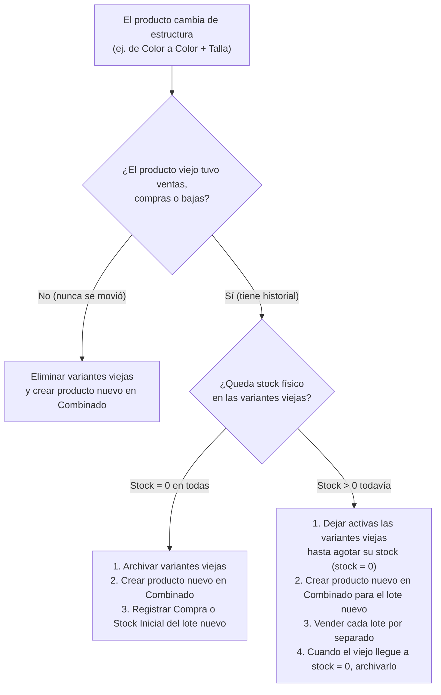

# Variantes de Producto y Migración entre Tipos

Este documento explica cómo funcionan las variantes en el catálogo, por qué el sistema protege la estructura de cada modelo y **qué pasos exactos debes seguir cuando un producto cambia de tipo de variante** (por ejemplo, de venderse solo por **Color** a llegar ahora por **Color y Talla**).

---

## 1. Los 3 Modos de Variante y cómo se guardan

Al crear un producto con variantes en `/admin/inventario/nuevo`, el constructor [`ProductVariantFields`](../src/components/admin/product-variant-fields.tsx) ofrece tres modos:

| Modo | Qué define | Ejemplo de etiqueta `variant` | Uso típico |
| :--- | :--- | :--- | :--- |
| **Color** | Solo atributo `Color` (paleta de 12 colores o **Otro color** con selector Hex + nombre) | `Verde`, `Rojo` | Audífonos, fundas, accesorios por color |
| **Texto** | Un atributo de texto personalizado (ej. `Talla`, `Capacidad`, `Medida`) | `M`, `128GB`, `500ml` | Ropa sin colores, almacenamiento, presentaciones |
| **Combinado** | `Color` + un atributo de texto (ej. `Talla`) | `Verde / M`, `Rojo / L` | Prendas, calzado, artículos con color y talla |

### Regla fundamental de inventario
Cada combinación física es un registro independiente en la tabla `products` con su propio **ID**, **SKU**, **código de barras**, **precio**, **CPP**, **stock** y **Kárdex**, agrupado con sus hermanas bajo un mismo código en `product_models`.

---

## 2. Regla de Integridad Estricta del Modelo

Todas las variantes que pertenecen a un mismo `product_models` **deben tener exactamente la misma estructura de atributos**.

- Si un modelo nació como **Color** (`Verde`, `Rojo`), todas sus variantes deben tener únicamente el atributo `Color`.
- Tanto en el formulario de edición (`updateProductAction`) como al añadir variantes hermanas (`addModelVariantsAction` + [`extendModelOptions`](../src/lib/model-variants.ts)), el sistema **bloquea mezclar estructuras distintas** (por ejemplo, agregar `Verde / M` dentro de un modelo que solo tiene `Color`) y bloquea variantes, SKUs o códigos de barras duplicados.

### ¿Por qué el sistema no permite "convertir" directamente un modelo viejo?
Porque las ventas pasadas (`sale_items`), compras pasadas (`purchase_items`) y movimientos de Kárdex apuntan al `product.id` de `Verde` (sin talla). Convertir ese registro en `Verde / M` adulteraría el historial contable haciendo creer que antes vendías o comprabas una talla que en ese lote no existía.

---

## 3. Cómo agregar variantes del mismo tipo (sin migrar)

Si el producto **mantiene el mismo tipo de variante** (por ejemplo, ya manejabas `Negro` y `Blanco` y ahora llegó `Azul`, o ya manejabas `Color + Talla` y llegó `Rojo / XL`):

1. **Opción A — Desde la edición del producto:**
   - Entra a `/admin/inventario`, abre cualquier variante de ese modelo y ve a **Editar** (`/admin/inventario/[id]/editar`).
   - Baja hasta la sección **Variantes de este modelo** ([`ModelSiblings`](../src/components/admin/model-siblings.tsx)).
   - Pulsa **+ Añadir nuevas variantes a este modelo**. El constructor se abrirá bloqueado automáticamente con la misma estructura del modelo y te avisará si intentas repetir una variante existente.
2. **Opción B — Desde Nuevo Producto:**
   - Ve a `/admin/inventario/nuevo`, elige **Con variantes** y selecciona el modelo en **Modelo base existente (opcional)**.

> **Nota sobre corrección de nombre o color de una variante:** Si editas los atributos o el color de una variante en `/admin/inventario/[id]/editar` (conservando la misma estructura del modelo), `updateProductAction` sincroniza automáticamente el texto `variant` y las `options` maestras en `product_models`.

---

## 4. Caso Práctico: Pasar de un tipo de variante a otro (ej. de solo `Color` a `Combinado`)

Supongamos que antes vendías **"Polera Básica"** solo por **Color** (`Verde` y `Rojo`) y desde este nuevo pedido el proveedor te entrega cada color por **Talla** (`S`, `M`, `L`, pasando a modo **Combinado**).

### Árbol de decisión según el stock actual

---

### Escenario 1: Las variantes viejas ya tienen `stock = 0`
Este es el caso más limpio:
1. Ve a `/admin/inventario` y **Archiva** cada variante vieja (`Verde`, `Rojo`). Como su stock es `0`, se retiran sin advertencias del POS y de la tienda web, manteniendo intacto su balance histórico.
2. Ve a `/admin/inventario/nuevo`, crea un **nuevo modelo** (dejando **"Crear nuevo modelo base automáticamente"**) con el nombre del producto y elige **Con variantes → Combinado** (`Color` + `Talla`).
3. Si las variantes son de una **compra nueva**, créalas con **Stock Inicial = `0`** y luego registra la factura en `/admin/compras/nueva`. Si ya las tenías antes de usar el sistema, usa Stock Inicial.

---

### Escenario 2: Todavía queda stock físico del producto viejo (`stock > 0`)
Supongamos que todavía tienes `4` unidades de `Verde` (sin talla) y ya te llegó el nuevo lote con `Verde / S`, `Verde / M`, `Verde / L`.

**Lo que NO debes hacer:**
- ❌ **NO archives todavía** la variante `Verde` vieja si aún la vas a vender (la ocultarías del POS y quedarían 4 unidades bloqueadas en almacén).
- ❌ **NO registres una Baja / Merma** sobre esas `4` unidades buenas solo para pasarlas al nuevo modelo: las mermas se reportan como pérdida/salida no vendida y distorsionarían tus reportes y utilidades.
- ❌ **NO sumes esas `4` unidades viejas como Stock Inicial dentro del nuevo producto combinado**: duplicarías el inventario físico y el capital en almacén (`4` en el viejo + `4` en el nuevo = `8`).

**Procedimiento correcto paso a paso:**
1. **Deja activas las variantes viejas con stock:** Mantén `Verde` (`4 u.`) activa hasta venderlas. Si ya hubiera alguna talla/color viejo en `0` (ej. `Rojo = 0`), esa sí puedes archivarla de inmediato.
2. **Crea el nuevo modelo combinado para el lote nuevo:**
   - Crea el producto nuevo en modo **Combinado** (`Color` + `Talla`).
   - *Consejo práctico de mostrador:* Mientras conviven ambos lotes en el POS, puedes nombrar temporalmente al viejo como *"Polera Básica (Lote anterior / Talla única)"* o al nuevo como *"Polera Básica v2"*, o distinguirlos por SKU/código de barras para que el cajero no confunda qué unidad está entregando.
3. **Registra la entrada del lote nuevo:** Si llegó con compra a proveedor, créalo con `Stock = 0` e ingrésalo por **Compras** (`/admin/compras/nueva`).
4. **Liquida y archiva el viejo:** En cuanto se vendan las últimas unidades del producto viejo y su stock llegue a `0`, entra a `/admin/inventario`, **Archiva** el producto viejo y, si usaste un nombre temporal para diferenciarlos, renombra el producto nuevo con el nombre definitivo.

---

### ¿Qué pasa con el balance contable y los reportes durante y después de la migración?
- **Compras y ventas del modelo viejo:** Quedan 100% preservadas con su costo (`cost_price`), precio de venta, margen e historial de caja en `/admin/reportes` y `/admin/analitica`.
- **Compras y ventas del modelo nuevo:** Se calculan de forma independiente por cada combinación (`Color / Talla`) con su propio Costo Promedio Ponderado (CPP).
- **Balance total del negocio:** Como nunca duplicaste unidades ni creaste pérdidas ficticias por merma, la suma del valor de almacén + ventas netas + utilidad bruta cuadra de manera exacta en todo momento.
