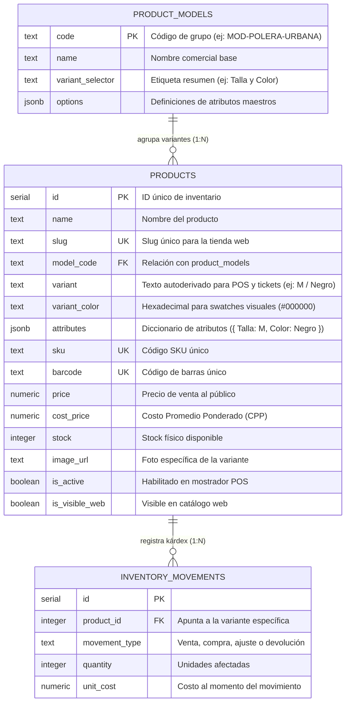
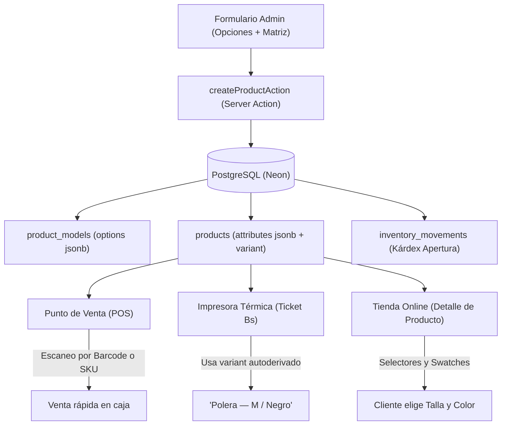

# Arquitectura y Funcionamiento del Sistema de Variantes (Estilo SaaS / Shopify)

Este documento detalla la arquitectura completa de variantes del sistema: modelos de datos en PostgreSQL con Drizzle ORM, almacenamiento dinámico en columnas `JSONB`, generador de matriz de combinaciones, e integración con el Punto de Venta (POS), Kárdex y la tienda online.

---

## 1. Visión General de la Arquitectura

El sistema implementa un modelo **híbrido relacional + JSONB**:
1. **Familia / Modelo del Producto (`product_models`):** Agrupa los productos que comparten una misma base y almacena la definición maestra de atributos (`options`).
2. **Variante Física en Inventario (`products`):** Cada combinación (ej: *Talla M / Color Negro*) es un registro independiente en la tabla `products` con su propio SKU, código de barras, precio de venta, costo promedio ponderado (CPP), stock físico y Kárdex.
3. **Atributos Dinámicos (`attributes: jsonb`):** Almacena el diccionario clave-valor exacto de la variante (ej: `{ "Talla": "M", "Color": "Negro" }`).



---

## 2. Esquema de Base de Datos (PostgreSQL & Drizzle ORM)

### 2.1. Tabla `product_models`
| Campo | Tipo SQL | Descripción |
| :--- | :--- | :--- |
| `code` | `text PRIMARY KEY` | Código único del grupo/modelo (ej: `MOD-12A8B`). |
| `name` | `text NOT NULL` | Nombre base del producto compartido por todas sus variantes. |
| `variant_selector`| `text` | Texto descriptivo del selector (ej: `Talla y color`). |
| `options` | `jsonb` | Arreglo JSON con las opciones configuradas. |

#### Estructura de `options` (JSONB):
```json
[
  {
    "id": "opt-1",
    "name": "Talla",
    "type": "text",
    "values": [
      { "name": "S" },
      { "name": "M" },
      { "name": "L" }
    ]
  },
  {
    "id": "opt-2",
    "name": "Color",
    "type": "color",
    "values": [
      { "name": "Negro", "hex": "#000000" },
      { "name": "Rojo", "hex": "#EF4444" }
    ]
  }
]
```

---

### 2.2. Tabla `products` (Variante Física)
| Campo | Tipo SQL | Descripción |
| :--- | :--- | :--- |
| `id` | `serial PRIMARY KEY`| Identificador único de inventario. |
| `model_code` | `text REFERENCES product_models(code)` | Llave foránea que agrupa la variante en su modelo. |
| `attributes` | `jsonb` | Diccionario clave-valor con los atributos de esta variante física. |
| `variant` | `text` | Texto autoderivado para tickets POS (ej: `"M / Negro"`). |
| `variant_color`| `text` | Código HEX para representación visual en storefront y POS. |
| `sku` | `text UNIQUE` | Código SKU independiente (autogenerado o personalizado). |
| `barcode` | `text UNIQUE` | Código de barras de la variante para pistolas lectoras POS. |
| `price` | `numeric(12,2)` | Precio de venta de esta combinación. |
| `cost_price` | `numeric(12,2)` | Costo inicial y Costo Promedio Ponderado vigente. |
| `stock` | `integer` | Existencias físicas reales de esta combinación. |
| `image_url` | `text` | Foto específica de la variante (WebP o URL). |

#### Estructura de `attributes` (JSONB):
```json
{
  "Talla": "M",
  "Color": "Negro"
}
```

---

## 3. Flujo en el Formulario de Administración

El componente `ProductVariantFields` ([src/components/admin/product-variant-fields.tsx](file:///c:/Users/neida.DESKTOP-801C70S/Desktop/sistemas%20next/sistema%20pos%20inventario%20ecommerce/src/components/admin/product-variant-fields.tsx)) replica la experiencia moderna de Shopify:

### Paso 1: Configurar Opciones Maestras
1. Se define hasta 3 atributos maestros (ej. *Talla*, *Color*, *Capacidad*).
2. Si el tipo es **Texto**: Se escribe el valor y se presiona `Enter` (ej: `S`, `M`, `L`).
3. Si el tipo es **Color**:
   * Paleta rápida de 12 colores frecuentes con 1 clic.
   * Selector interactivo de color personalizado (selector Hex + nombre del color).

### Paso 2: Generar Matriz Automática (Producto Cartesiano)
* Al hacer clic en **"Generar matriz de combinaciones"**, el sistema realiza el producto cartesiano:
  $$\text{Tallas } (S, M, L) \times \text{Colores } (\text{Negro}, \text{Rojo}) = 6 \text{ variantes físicas}$$
* Si alguna variante ya existía y tenía precio o stock configurado, el algoritmo **preserva sus valores intactos**.

### Paso 3: Tarjetas de Variantes Físicas
Cada variante generada cuenta con:
* **Cabecera:** Muestra directamente las etiquetas de los atributos (`Talla: M` | `Color: Negro` con su círculo cromático) sin requerir escribir un "nombre identificador" manual.
* **Fila 1 (Económica & Stock):**
  * Precio Venta (Bs.) `[Obligatorio]`
  * Costo Inicial (Bs.) `[Opcional, default: 0]`
  * Stock Inicial (u.) `[Opcional, default: 0]`
* **Fila 2 (Visible permanentemente sin botones ocultos):**
  * **SKU:** Campo con botón para edición manual o autogeneración (`PROD-XXXX`).
  * **Código de barras:** Campo listo para lectura con escáner físico.
  * **Foto específica (Opcional):**
    * Carga directa de archivo local con **optimización automática a formato WebP**.
    * Opcionalmente permite ingresar URL remota.
    * Botón de 1 clic **"+ Añadir a galería general"** para que la foto de la variante también aparezca en el carrusel de la tienda online.

---

## 4. Integración con el POS, Kárdex y Tienda Online



1. **Punto de Venta (Caja):**
   * El cajero puede escanear con la pistola el código de barras o SKU de la variante exacta (*ej. Talla M / Negro*).
   * La búsqueda es directa sobre la tabla `products` en tiempo constante ($O(1)$) mediante el índice único de código de barras.
2. **Tickets de Impresión Térmica:**
   * La impresora no necesita parsear el JSON; lee directamente el campo `variant` precalculado (`"M / Negro"`).
3. **Kárdex y Contabilidad:**
   * Cada variante registra su propio historial de entradas y salidas en `inventory_movements`.
   * El Costo Promedio Ponderado (CPP) se calcula independientemente para cada talla/color.
4. **Tienda Online (Ecommerce):**
   * El cliente visualiza el selector de variantes con swatches de color interactivos y disponibilidad de stock en tiempo real.

---

## 5. Archivos del Módulo en el Repositorio

* **Esquema de Base de Datos:** [src/db/schema.ts](file:///c:/Users/neida.DESKTOP-801C70S/Desktop/sistemas%20next/sistema%20pos%20inventario%20ecommerce/src/db/schema.ts)
* **Migración SQL:** [drizzle/0005_product_attributes_jsonb.sql](file:///c:/Users/neida.DESKTOP-801C70S/Desktop/sistemas%20next/sistema%20pos%20inventario%20ecommerce/drizzle/0005_product_attributes_jsonb.sql)
* **Componente de Variantes:** [src/components/admin/product-variant-fields.tsx](file:///c:/Users/neida.DESKTOP-801C70S/Desktop/sistemas%20next/sistema%20pos%20inventario%20ecommerce/src/components/admin/product-variant-fields.tsx)
* **Formulario de Producto:** [src/components/admin/product-form.tsx](file:///c:/Users/neida.DESKTOP-801C70S/Desktop/sistemas%20next/sistema%20pos%20inventario%20ecommerce/src/components/admin/product-form.tsx)
* **Validaciones Zod:** [src/lib/validations/product.ts](file:///c:/Users/neida.DESKTOP-801C70S/Desktop/sistemas%20next/sistema%20pos%20inventario%20ecommerce/src/lib/validations/product.ts)
* **Operaciones SQL Transaccionales:** [src/db/operations/catalog.ts](file:///c:/Users/neida.DESKTOP-801C70S/Desktop/sistemas%20next/sistema%20pos%20inventario%20ecommerce/src/db/operations/catalog.ts)
