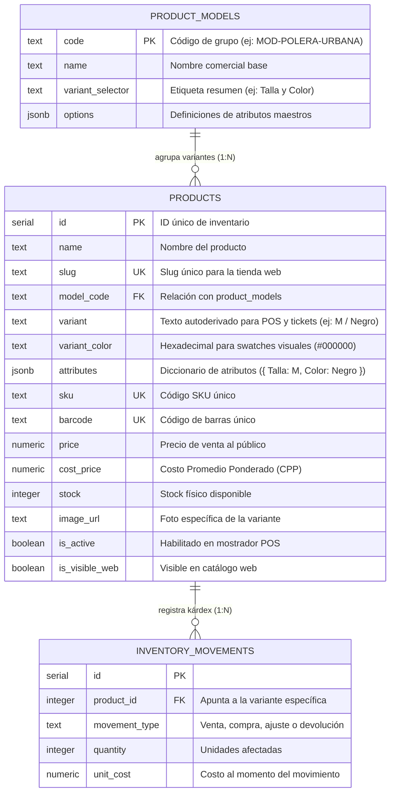
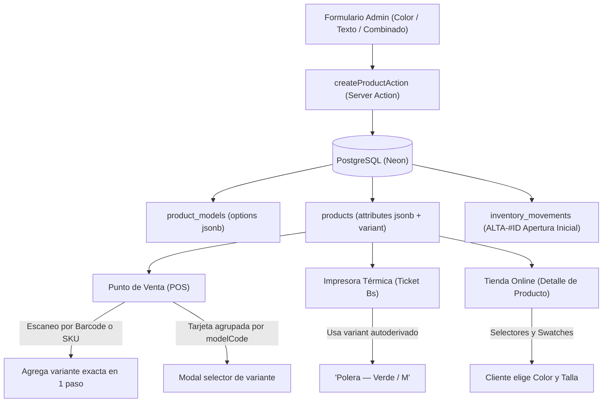

# Arquitectura y Funcionamiento del Sistema de Variantes (Estilo SaaS / Shopify)

Este documento detalla la arquitectura técnica de variantes del sistema: modelos de datos en PostgreSQL con Drizzle ORM, almacenamiento dinámico en columnas `JSONB`, el constructor de variantes de 3 modos, ciclo de vida e integración con el Punto de Venta (POS), Kárdex y la tienda online.

> Para manuales operativos paso a paso (eliminar vs. archivar, migración de solo Color a Color + Talla, POS y cajas), consulta el índice en [docs/README.md](./README.md).

---

## 1. Visión General de la Arquitectura

El sistema implementa un modelo **híbrido relacional + JSONB**:
1. **Familia / Modelo del Producto (`product_models`):** Agrupa los productos que comparten una misma base y almacena la definición maestra de atributos (`options`).
2. **Variante Física en Inventario (`products`):** Cada combinación (ej: *Talla M / Color Negro*) es un registro independiente en la tabla `products` con su propio SKU, código de barras, precio de venta, costo promedio ponderado (CPP), stock físico y Kárdex.
3. **Atributos Dinámicos (`attributes: jsonb`):** Almacena el diccionario clave-valor exacto de la variante (ej: `{ "Talla": "M", "Color": "Negro" }`).



---

## 2. Esquema de Base de Datos (PostgreSQL & Drizzle ORM)

### 2.1. Tabla `product_models`
| Campo | Tipo SQL | Descripción |
| :--- | :--- | :--- |
| `code` | `text PRIMARY KEY` | Código único del grupo/modelo (ej: `MOD-12A8B`). |
| `name` | `text NOT NULL` | Nombre base del producto compartido por todas sus variantes. |
| `variant_selector`| `text` | Texto descriptivo del selector (ej: `Talla y color`). |
| `options` | `jsonb` | Arreglo JSON con las opciones configuradas. |

#### Estructura de `options` (JSONB):
```json
[
  {
    "id": "opt-1",
    "name": "Talla",
    "type": "text",
    "values": [
      { "name": "S" },
      { "name": "M" },
      { "name": "L" }
    ]
  },
  {
    "id": "opt-2",
    "name": "Color",
    "type": "color",
    "values": [
      { "name": "Negro", "hex": "#000000" },
      { "name": "Rojo", "hex": "#EF4444" }
    ]
  }
]
```

---

### 2.2. Tabla `products` (Variante Física)
| Campo | Tipo SQL | Descripción |
| :--- | :--- | :--- |
| `id` | `serial PRIMARY KEY`| Identificador único de inventario. |
| `model_code` | `text REFERENCES product_models(code)` | Llave foránea que agrupa la variante en su modelo. |
| `attributes` | `jsonb` | Diccionario clave-valor con los atributos de esta variante física. |
| `variant` | `text` | Texto autoderivado para tickets POS (ej: `"M / Negro"`). |
| `variant_color`| `text` | Código HEX para representación visual en storefront y POS. |
| `sku` | `text UNIQUE` | Código SKU independiente (autogenerado o personalizado). |
| `barcode` | `text UNIQUE` | Código de barras de la variante para pistolas lectoras POS. |
| `price` | `numeric(12,2)` | Precio de venta de esta combinación. |
| `cost_price` | `numeric(12,2)` | Costo inicial y Costo Promedio Ponderado vigente. |
| `stock` | `integer` | Existencias físicas reales de esta combinación. |
| `image_url` | `text` | Foto específica de la variante (WebP o URL). |

#### Estructura de `attributes` (JSONB):
```json
{
  "Talla": "M",
  "Color": "Negro"
}
```

---

## 3. Flujo en el Formulario de Administración

El componente `ProductVariantFields` ([src/components/admin/product-variant-fields.tsx](../src/components/admin/product-variant-fields.tsx)) organiza la carga de variantes de forma guiada con integridad estricta de estructura:

### Paso 1: Elegir el Tipo de Variante (3 Modos)
1. **Color:** Selector visual compacto (`ColorDropdown`) con paleta de 12 colores frecuentes o botón **"Otro color"** con selector hexadecimal + nombre personalizado.
2. **Texto:** Un atributo de texto configurable (por defecto `Talla`, o `Capacidad`, `Medida`, etc.) compartido por todas las variantes de la lista.
3. **Combinado:** Combina **Color** + un atributo de texto (ej. `Color: Verde` + `Talla: M` → `"Verde / M"`).

> **Regla de bloqueo:** Una vez añadida la primera variante (o cuando se está añadiendo a un modelo existente), el tipo queda bloqueado para evitar mezclar variantes incompatibles dentro del mismo `product_models`. Además, las variantes ya creadas se deshabilitan en vivo para evitar duplicados.

### Paso 2: Añadir Variantes y Aplicar Valores en Bloque (Opcional)
* Con cada combinación seleccionada se pulsa **"Añadir variante"** (o `Enter`), evitando duplicados por nombre o atributos normalizados.
* Si varias variantes comparten precio de venta, costo inicial o stock inicial, se pueden rellenar en la barra **"Aplicar a todas"**.

### Paso 3: Tarjetas de Variantes Físicas y Hermanas del Modelo
Cada variante añadida cuenta con:
* **Cabecera:** Muestra directamente la identidad cromática (cuadro redondeado) y la etiqueta autoderivada (`Verde / M`).
* **Fila Económica & Stock Inicial:**
  * Precio de Venta (Bs) `[Obligatorio]`
  * Costo Inicial (Bs) `[Opcional, default: 0]`
  * Stock Inicial (u.) `[Opcional, default: 0]`
* **Fila Operativa:**
  * **SKU:** Edición manual o autogeneración (`PROD-XXXX`).
  * **Código de barras:** Campo listo para escáner físico POS.
  * **Foto específica (Opcional):** Carga de archivo local con conversión automática a `.webp` o URL `https://`, más botón para añadir a la galería general.

Al editar una variante en `/admin/inventario/[id]/editar`:
* El módulo [`ModelSiblings`](../src/components/admin/model-siblings.tsx) lista todas las variantes hermanas del modelo, permite activar/archivar o eliminar (cuando `canHardDelete = true` mediante [`ProductLifecycle`](../src/components/admin/product-lifecycle.tsx)) y permite **añadir nuevas variantes al modelo** conservando exactamente las mismas dimensiones (`extendModelOptions`).

---

## 4. Integración con el POS, Kárdex y Tienda Online



1. **Punto de Venta (Caja):**
   * **Pistola lectora / SKU:** Al presionar `Enter` con código de barras o SKU exacto, agrega la variante física directamente al carrito.
   * **Cuadrícula táctil agrupada:** Los modelos con más de 1 variante activa se muestran como una sola tarjeta agrupada (`N variantes`, rango de precios, stock total) que abre un modal selector con foto, cuadro de color, SKU, stock disponible y cantidad actual en el carrito.
2. **Tickets de Impresión Térmica:**
   * La impresora no necesita parsear el JSON; lee directamente el campo `variant` precalculado (`"Verde / M"`).
3. **Kárdex y Ciclo de Vida:**
   * Cada variante registra su propio historial independiente en `inventory_movements` y su propio Costo Promedio Ponderado (CPP).
   * Solo puede eliminarse físicamente (`deleteUnusedProductQuery`) si no tiene filas en `sale_items`, `purchase_items`, `inventory_adjustment_items` ni movimientos distintos a `product_creation`; de lo contrario se archiva (`isActive = false`, ocultando automáticamente de POS, compras y tienda online sin alterar reportes ni cajas).
4. **Tienda Online (Ecommerce):**
   * El cliente visualiza únicamente productos activos y visibles (`isActive = true` e `isVisibleWeb = true`), con selectores de variantes, swatches de color y disponibilidad de stock en tiempo real.

---

## 5. Archivos del Módulo en el Repositorio

* **Esquema de Base de Datos:** [src/db/schema.ts](../src/db/schema.ts)
* **Migración SQL:** [drizzle/0005_product_attributes_jsonb.sql](../drizzle/0005_product_attributes_jsonb.sql)
* **Constructor de Variantes:** [src/components/admin/product-variant-fields.tsx](../src/components/admin/product-variant-fields.tsx)
* **Formulario de Producto:** [src/components/admin/product-form.tsx](../src/components/admin/product-form.tsx)
* **Hermanas y Ciclo de Vida:** [src/components/admin/model-siblings.tsx](../src/components/admin/model-siblings.tsx) y [src/components/admin/product-lifecycle.tsx](../src/components/admin/product-lifecycle.tsx)
* **Validaciones y Reglas de Modelo:** [src/lib/validations/product.ts](../src/lib/validations/product.ts) y [src/lib/model-variants.ts](../src/lib/model-variants.ts)
* **Operaciones SQL Transaccionales:** [src/db/operations/catalog.ts](../src/db/operations/catalog.ts)
* **Guías Operativas Relacionadas:** [docs/README.md](./README.md), [01-productos-eliminar-vs-archivar.md](./01-productos-eliminar-vs-archivar.md) y [02-variantes-y-migracion.md](./02-variantes-y-migracion.md)
